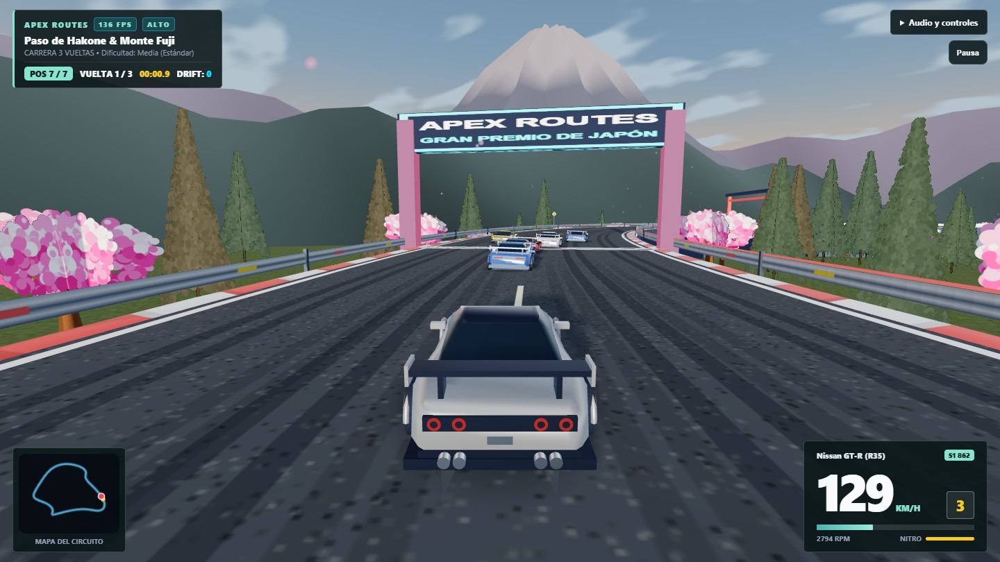
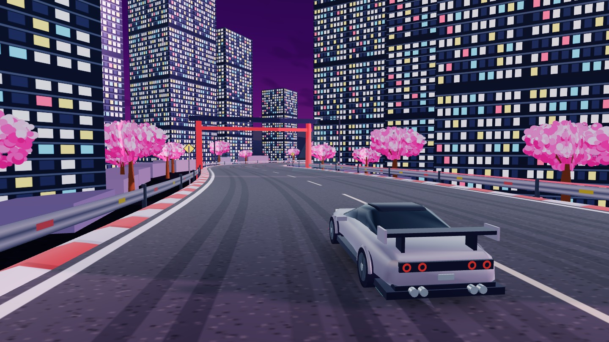
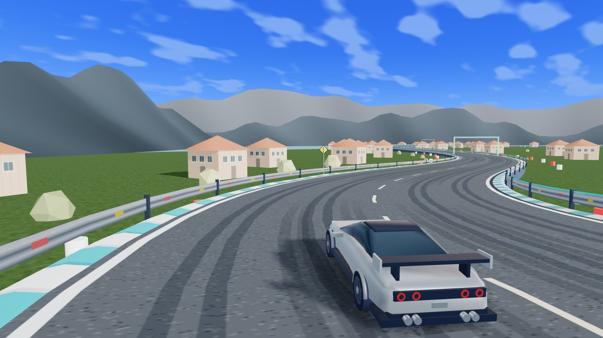
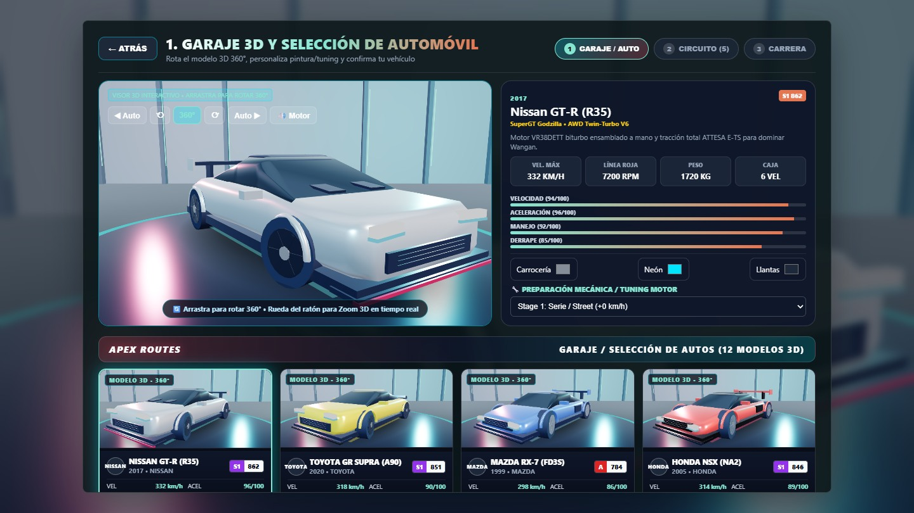

# Apex Routes

**Carreras 3D en Japón y Perú.** Recorre autopistas nocturnas, el paso de Hakone y circuitos andinos. Elige entre 12 autos, ajusta la pintura y la preparación mecánica, y compite contra seis rivales en circuitos cerrados.

[Descargar para Windows x64](https://github.com/Daniel-ux1026/forza-horizon-japan/releases/tag/v2.0.0) · [Ejecutar en el navegador](#ejecutar-en-el-navegador) · [Controles](#controles)



## Circuitos

| Circuito | Distancia por vuelta | Ambiente |
| --- | ---: | --- |
| Tokio · Shuto C1 y Wangan | 2,21 km | Autopista nocturna, viaductos y Torre de Tokio |
| Hakone · Monte Fuji | 2,17 km | Bosque de montaña, cerezos y puertas torii al atardecer |
| Shibuya y Akihabara | 2,15 km | Curvas urbanas, carteles y fachadas iluminadas |
| Arequipa y Trujillo | 2,20 km | Autódromo, desierto costero y volcán Misti |
| Cusco y Puno | 2,23 km | Praderas del altiplano, poblado andino y lago Titicaca |

| Shibuya y Akihabara | Cusco y Puno |
| --- | --- |
|  |  |

## Modos de juego

- **Carrera de circuito.** Tres vueltas contra seis rivales controlados por IA.
- **Contrarreloj.** Pasa por los puntos de control para sumar tiempo y completar la carrera.
- **Persecución policial.** Escapa de las patrullas mientras gestionas el medidor de arresto.

Hay cuatro dificultades. El garaje incluye doce modelos procedurales con visor 360°, pintura, color de llantas y neón, y tres niveles de preparación. La radio incorpora música sintetizada y puede reproducir archivos de audio locales.



## Jugar en Windows

1. Descarga `Apex-Routes-2.0.0-Windows-x64-Portable.exe` desde la versión publicada. [GitHub Releases](https://github.com/Daniel-ux1026/forza-horizon-japan/releases/tag/v2.0.0)
2. Abre el archivo. El ejecutable incluye el motor de renderizado y los recursos del juego. Puedes jugar sin instalación ni conexión.
3. En **Opciones → Calidad gráfica**, elige **Alto** para renderizar hasta 1920 × 1080 con sombras de 2048 px. **Equilibrado** reduce el límite a 1600 × 900 y usa sombras de 1024 px. **Ligero** limita a 1280 × 720 y desactiva las sombras dinámicas.

## Ejecutar en el navegador

Usa Node.js 18 o superior para iniciar el servidor local. El juego requiere un navegador con WebGL y aceleración gráfica. El servidor y las pruebas funcionan sin instalar paquetes npm.

```bash
git clone https://github.com/Daniel-ux1026/forza-horizon-japan.git
cd forza-horizon-japan
npm start
```

Abre `http://localhost:8080`. En un móvil en la misma red puedes abrir la dirección que muestra el servidor y activar los controles táctiles.

## Controles

| Acción | Teclado |
| --- | --- |
| Acelerar | `W` / `↑` |
| Frenar o dar marcha atrás | `S` / `↓` |
| Girar | `A` / `D` o `←` / `→` |
| Freno de mano | `Espacio` |
| Nitro | `Shift` |
| Cámara | `C` |
| Garaje | `G` |
| Pausa | `P` / `Esc` |
| Reiniciar | `R` |
| Siguiente canción | `M` |

También admite mandos compatibles con la Gamepad API y botones táctiles en pantalla.

## Desarrollo

```bash
npm test
```

La suite verifica los cinco circuitos, los doce autos, el flujo de menús, las físicas, la IA, la cámara, las colisiones y los tres modos de juego. Usa Three.js con un entorno de navegador simulado. Las capturas de este README se tomaron con WebGL en ejecución.

Para generar el portable en Windows x64, usa Node.js 22.12 o superior y ejecuta:

```bash
npm ci
npm run build:portable
```

El archivo se genera en `dist/`. Para iniciar la aplicación de escritorio durante el desarrollo, ejecuta `npm run desktop`.

| Ruta | Responsabilidad |
| --- | --- |
| `js/world.js` | Geometría, materiales, atmósfera, escenarios y garaje 3D |
| `js/game.js` | Simulación, estados del juego, controles, cámara y HUD |
| `js/data.js` | Catálogo de autos, circuitos, modos y música |
| `js/audio.js` | Radio, síntesis del motor y efectos de sonido |
| `desktop/main.cjs` | Ventana de Electron y carga local de recursos |
| `tests/verify-engine.mjs` | Verificación funcional del motor |
| `unity-webgl-architecture/` | Documentación de arquitectura para una posible versión en Unity |

## Autoría

Apex Routes es un proyecto independiente de Daniel Olivos, inspirado en Forza Horizon 6 y en la cultura automovilística de Japón y Perú. Las imágenes muestran el juego de este repositorio. [Perfil de Daniel Olivos](https://github.com/Daniel-ux1026)
